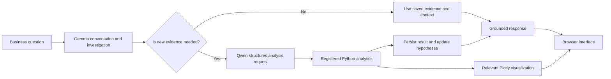

# BizScopeAI

### A conversational business analyst that investigates data with evidence.

BizScopeAI helps users explore business questions through a guided investigation. It frames possible explanations, decides when new numerical evidence is needed, runs registered analytics, and uses the results to inform the conversation. Visualizations are generated from the same analysis results shown in the response.

> **Project status:** Local, single-user student project prototype. Not intended for public or shared network deployment.

## What it does

- **Investigates conversationally:** Ask an open-ended business question and explore plausible hypotheses before running calculations.
- **Chooses when evidence is needed:** Follow-up questions can use saved evidence; new analytical requests are routed to an available analysis.
- **Keeps arithmetic reproducible:** Python analytics calculate metrics, rankings, and comparisons. The language models explain the results rather than serve as the source of numerical truth.
- **Updates the investigation:** New results can inform hypothesis status and the next useful question.
- **Shows relevant charts:** Plotly charts are generated from analysis outputs and rendered in the browser interface.
- **Works with uploaded CSVs:** The data pipeline profiles datasets and maps common business fields to supported analyses.

## How it works



Gemma (`gemma3:4b`) handles conversational investigation and interpretation. Qwen (`qwen3:4b`) helps structure requests when new evidence is required. Registered Python functions produce the measured results; the models do not calculate the reported figures.

## Analytics

The registered catalogue includes revenue and monthly trends, category and product performance, profitability, discount and regional performance, customer metrics, correlations, order metrics, significant changes, segment comparisons, marketing performance, distributions, and outlier summaries. Analyses require the relevant fields to be present in the uploaded dataset.

BizScopeAI reports descriptive results. A correlation or group comparison can reveal a pattern, but does not by itself establish causation or statistical significance. Row-level average profit margin and aggregate profit margin are distinct measures and should be interpreted separately.

## Tech stack

| Area | Technology |
| --- | --- |
| API | Python, FastAPI, Uvicorn |
| Investigation workflow | LangGraph |
| Models | Ollama with Gemma and Qwen |
| Analytics | Pandas, NumPy |
| Charts | Plotly |
| Persistence | PostgreSQL, SQLAlchemy |
| Web interface | HTML, CSS, JavaScript |
| Tests | pytest |

The primary web interface is served by FastAPI. It does not require React, Node.js, npm, or a frontend build step. A legacy Streamlit interface is also retained.

## Run locally

### Prerequisites

- Windows PowerShell (commands below use PowerShell syntax)
- Python 3.10 or newer
- PostgreSQL 14 or newer, running locally
- Ollama with `gemma3:4b` and `qwen3:4b`

### Setup

```powershell
cd N:\BizScopeAI
py -3.10 -m venv venv
.\venv\Scripts\Activate.ps1
python -m pip install --upgrade pip
pip install -r requirements.txt
Copy-Item .env.example .env
```

Edit `.env` and set `DATABASE_URL` for your local PostgreSQL database. Keep `.env` private; it is excluded from Git. Start PostgreSQL and Ollama, then install the configured models if needed:

```powershell
ollama pull gemma3:4b
ollama pull qwen3:4b
python -m Backend.init_db
```

Start the application from the project root:

```powershell
python -m uvicorn Backend.main:app --host 127.0.0.1 --port 8000
```

Open [http://127.0.0.1:8000](http://127.0.0.1:8000). Keep the app bound to `127.0.0.1`; the prototype does not include authentication or multi-user access controls.

### Optional Streamlit fallback

```powershell
python -m streamlit run frontend/app.py --server.address 127.0.0.1 --server.port 8501
```

## Try an investigation

Upload `dataset/samplesuperstore.csv` in the app, then try this sequence:

1. “Sales are strong, but I’m not sure they’re translating into profit. Help me frame a few explanations; don’t run an analysis yet.”
2. “Which explanation can this dataset test? Recommend the most useful first analysis, but don’t run it yet.”
3. “Compare total revenue and total profit by region. Rank regions by total profit and show a visualization.”
4. “Update the investigation hypotheses using those results. What does the analysis show, and what remains uncertain?”

This sequence demonstrates conversational framing, evidence selection, analysis, chart rendering, and evidence-informed follow-up.

## Run tests

Run the automated tests with:

```powershell
python -m pytest Evaluation/test_cases -q
```

Database integration tests require the configured local PostgreSQL service. The live Ollama end-to-end test is opt-in because it makes slow model calls:

```powershell
$env:RUN_LIVE_OLLAMA_E2E='1'
python -m pytest Evaluation/test_main/test_full_e2e.py -q
```

## Repository map

```text
Backend/       API, investigation graph, prompts, analytics, persistence
Evaluation/    Unit and integration tests plus evaluation reports
dataset/      Sample and test CSV datasets
frontend/     Browser UI and optional Streamlit fallback
scripts/      Local backup and restore utility
```

## Scope and limitations

BizScopeAI is a local student prototype, not a hosted business service. It currently assumes one trusted local user. It has no authentication, tenant isolation, or authorization layer for shared access. Do not expose it to a network or use it with sensitive business data. Model quality depends on the local models, available context, and dataset quality; unsupported questions should be treated as outside the current analytics catalogue.

## License

No license is currently specified. Contact the repository owner before reusing or redistributing the project.
