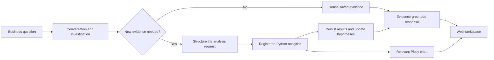

<div align="center">

# BizScopeAI

### Business questions, investigated with evidence.

**A conversational analytics workspace for exploring business performance, testing explanations, and turning verified data into clear next steps.**

[Capabilities](#capabilities) · [How it works](#how-it-works) · [Run locally](#run-locally) · [Evaluation](#evaluation)

</div>

---

## Overview

BizScopeAI is a local business analysis application built around an investigation loop. Start with a broad question, develop possible explanations, identify what the data can test, and use new findings to guide the next question.

The language models support the conversation and structure analytical requests. **Registered Python analytics calculate the reported metrics.** Tables and Plotly charts are grounded in those same results.

## Capabilities

| Explore | Measure | Investigate |
| --- | --- | --- |
| Frame a business question and compare plausible hypotheses | Analyze revenue, profit, margins, regions, products, categories, customers, discounts, and trends | Reuse saved evidence, update hypothesis status, and identify what remains unknown |
| Continue with natural-language follow-ups | Calculate rankings and comparisons with reproducible Python functions | Render charts from the measured analysis results |

CSV uploads are profiled and mapped to supported business fields. Available analyses depend on the columns in the uploaded data.

## How it works



**Gemma** (`gemma3:4b`) supports investigation and response generation. **Qwen** (`qwen3:4b`) structures requests when new evidence is needed. Python analytics remain the source of numerical results.

## Analytics and interpretation

The catalogue covers business performance, regional and category comparisons, monthly trends, product and customer metrics, discount performance, correlations, order metrics, marketing efficiency, distribution statistics, and outlier summaries.

Results are descriptive. A difference or correlation can suggest a pattern, but does not establish its cause or statistical significance. BizScopeAI distinguishes row-level average profit margin from aggregate profit margin; each answers a different question.

## Technology

**Python · FastAPI · LangGraph · Ollama · Pandas · NumPy · Plotly · PostgreSQL · SQLAlchemy · HTML · CSS · JavaScript · pytest**

The primary browser interface is served directly by FastAPI. It uses native web technologies and does not require a Node.js or npm build. A Streamlit interface is retained as an alternate client.

## Run locally

### Requirements

- Python 3.10 or newer
- PostgreSQL 14 or newer
- Ollama with `gemma3:4b` and `qwen3:4b`

### Install

From the repository root in PowerShell:

```powershell
py -3.10 -m venv venv
.\venv\Scripts\Activate.ps1
python -m pip install --upgrade pip
pip install -r requirements.txt
Copy-Item .env.example .env
```

Set `DATABASE_URL` in `.env` for your local PostgreSQL database. Keep `.env` private; it is excluded from Git. Start PostgreSQL and Ollama, then prepare the database and local models:

```powershell
ollama pull gemma3:4b
ollama pull qwen3:4b
python -m Backend.init_db
```

### Start

```powershell
python -m uvicorn Backend.main:app --host 127.0.0.1 --port 8000
```

Open [http://127.0.0.1:8000](http://127.0.0.1:8000). The application is configured for local access on `127.0.0.1`.

### Optional Streamlit client

```powershell
python -m streamlit run frontend/app.py --server.address 127.0.0.1 --server.port 8501
```

## Example investigation

Upload `dataset/samplesuperstore.csv`, then explore:

1. “Sales are strong, but I’m not sure they’re translating into profit. Help me frame possible explanations; don’t analyze yet.”
2. “Which explanation can this dataset test? Recommend a useful first analysis, but don’t run it yet.”
3. “Compare revenue and profit by region. Rank regions by profit and visualize the results.”
4. “Update the hypotheses using the results. What do we know, and what remains uncertain?”

## Evaluation

Run the automated test suite:

```powershell
python -m pytest Evaluation/test_cases -q
```

Database integration tests require the configured PostgreSQL service. The live end-to-end test uses local Ollama models and is opt-in:

```powershell
$env:RUN_LIVE_OLLAMA_E2E='1'
python -m pytest Evaluation/test_main/test_full_e2e.py -q -s
```

The live benchmark checks response numbers against a small dataset with known expected results. It measures that benchmark case; it is not a general accuracy guarantee for every response.

## Repository layout

```text
Backend/       API, investigation workflow, analytics, persistence
Evaluation/    Automated tests and evaluation tools
dataset/       Sample and test datasets
frontend/      Browser interface and alternate Streamlit client
scripts/       Local backup and restore utilities
```

## Deployment and data

BizScopeAI is designed for one local user. It does not currently provide authentication or multi-user data isolation. Keep it bound to localhost and do not expose it to a network or use it with sensitive business data.

## License

No license is currently specified. Contact the repository owner before reuse or redistribution.
